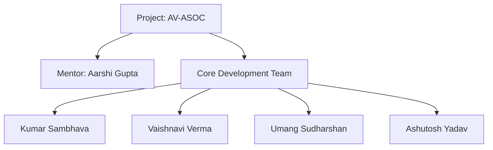
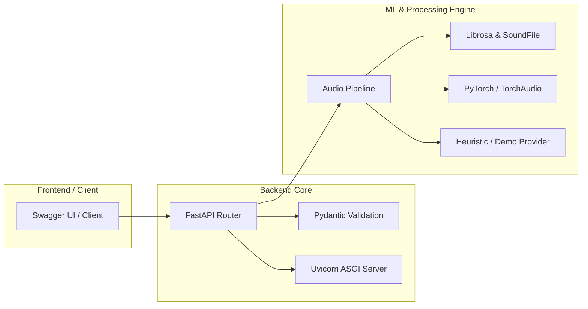

<div align="center">

# 🛡️ AI-Driven Deepfake Voice & Audio Anti-Spoofing Operations Center (AV-ASOC)

[](https://www.python.org/)
[](https://fastapi.tiangolo.com/)
[](https://pytorch.org/)

*An enterprise-grade, real-time synthetic voice detection and threat mitigation platform.*

</div>

---

## 👥 Project Team & Mentorship



---

## 📌 1. Project Overview

* **Project Title:** AI-Driven Deepfake Voice & Audio Anti-Spoofing Operations Center (AV-ASOC)
* **Team Members:** Kumar Sambhava, Vaishnavi Verma, Umang Sudharshan, Ashutosh Yadav
* **Technology Stack:** Python, FastAPI, Uvicorn, PyTorch, TorchAudio, Librosa, SoundFile, Pydantic, Git, GitHub
* **Project Guide/Mentor:** Aarshi Gupta
* **Project Objective:** To build a robust, FastAPI-based backend and web platform capable of detecting synthetic or AI-generated voice deepfakes in real-time. The system utilizes a sliding window approach for granular audio analysis across timelines, providing secure and reliable verification to combat audio spoofing and voice cloning threats.

---

## ⚠️ 2. Problem Statement

With the rapid advancements in generative AI and text-to-speech (TTS) technologies like ElevenLabs, creating hyper-realistic voice clones has become alarmingly easy. These synthesized voices pose severe cybersecurity threats, including voice phishing (vishing), financial fraud, identity theft, and unauthorized access to secure systems. There is an urgent need for an automated anti-spoofing detection system that can reliably distinguish between genuine human speech (bonafide) and AI-generated voice spoofs from audio uploads.

---

## ⚡ 3. Core Features

* **Sliding Window Audio Analysis:** Automatically segments audio streams or files into manageable temporal windows to evaluate risk scores and detect localized spoofing artifacts.
* **Dual-Provider Architecture:** Supports seamless switching between deep learning model inference (PyTorch checkpoints) and a rule-based heuristic "demo" provider for reliable local development and presentations.
* **High-Performance REST API:** Built with FastAPI and Uvicorn to handle asynchronous audio validation, strict format requirements (e.g., 16kHz PCM WAV), and structured JSON responses.
* **Interactive Documentation:** Out-of-the-box Swagger UI integration (`/docs`) for easy endpoint visualization, testing, and client integration.

---

## 🛠️ 4. Technology Stack



* **Backend Framework:** Python (v3.10+), FastAPI, Uvicorn, Pydantic
* **Machine Learning & Audio Processing:** PyTorch, TorchAudio, Librosa, SoundFile
* **Environment & Dependency Management:** Virtual Environment (`venv`), `pip`
* **Version Control & Collaboration:** Git, GitHub

---

## 📂 5. Project Structure

```text
avasoc-backend/
│
├── app/
│   ├── main.py              # FastAPI application entry point and routing
│   ├── ml/                  # ML models, sliding window logic, and detection providers
│   └── core/                # Configuration and environment management
│
├── venv/                    # Python virtual environment
├── requirements.txt         # Project dependencies
├── README.md                # Project documentation
└── .env                     # Environment variables configuration

```

---

## 🚀 6. Installation and Execution

Follow these steps to set up and run the project locally using PowerShell:

1. **Clone the repository and navigate to the project folder:**
```powershell
cd "C:\Users\ROG\Desktop\AV ASOC\avasoc-backend"

```


2. **Create and activate a Python virtual environment:**
```powershell
python -m venv venv
.\venv\Scripts\Activate.ps1

```


3. **Install project dependencies:**
```powershell
pip install -r requirements.txt

```


4. **Configure environment variables and start the FastAPI server:**
```powershell
$env:AVASOC_ENV="dev"
$env:AVASOC_DETECTION_PROVIDER="demo"
uvicorn app.main:app --reload --host 127.0.0.1 --port 8000

```


5. **Access the Application:**
* Open your browser and go to `http://127.0.0.1:8000` or view the interactive API documentation at `http://127.0.0.1:8000/docs`.


---

## 📊 7. Screenshots / Output

*(Add screenshots of your FastAPI Swagger UI documentation, audio upload dashboard, and JSON risk assessment response here.)*

---

## 🧠 8. DSA Concepts Used

| DSA / Algorithm | Where Used | Purpose |
| --- | --- | --- |
| **Sliding Window** | Audio stream segmentation | Process continuous audio in fixed-size frames for continuous inference. |
| **Priority Queue / Min-Max Heap** | Alert/event management | Prioritize high-risk audio windows or incidents by anomaly confidence. |
| **Trie** | Fraud-script keyword detection | Fast prefix-based matching for configured phrases/keywords. |
| **String Matching** | Transcript analysis | Find suspicious phrases efficiently in transcribed speech. |
| **Queue / Deque** | Audio/event buffering | Maintain ordered stream chunks and manage recent events. |
| **HashMap / Dictionary** | Session and model registry | $O(1)$-average lookup for sessions, model IDs, configuration, and metadata. |
| **Sorting** | Incident/timeline views | Order events by confidence, time, or severity. |
| **Graph (optional)** | Campaign/relationship analysis | Represent relationships among sessions, identities, etc. |

---

## 🎓 9. Learning Outcomes

* Gained hands-on experience in building asynchronous, high-performance web backends using **FastAPI** and **Uvicorn**.
* Mastered audio signal processing workflows and feature manipulation using **Librosa**, **TorchAudio**, and **PyTorch**.
* Learned how to design modular software architectures that support dual execution modes (heuristic fallback vs. deep learning inference).
* Enhanced skills in environment configuration and virtual environment management.

---

## 🔮 10. Future Scope

* Integration of advanced state-of-the-art transformer-based deepfake detection models.
* Support for real-time microphone stream analysis via WebSockets.
* Expansion of frontend web dashboards for visual waveform and score timeline rendering.
* Implementation of automated containerization using Docker and Kubernetes.

```

```
